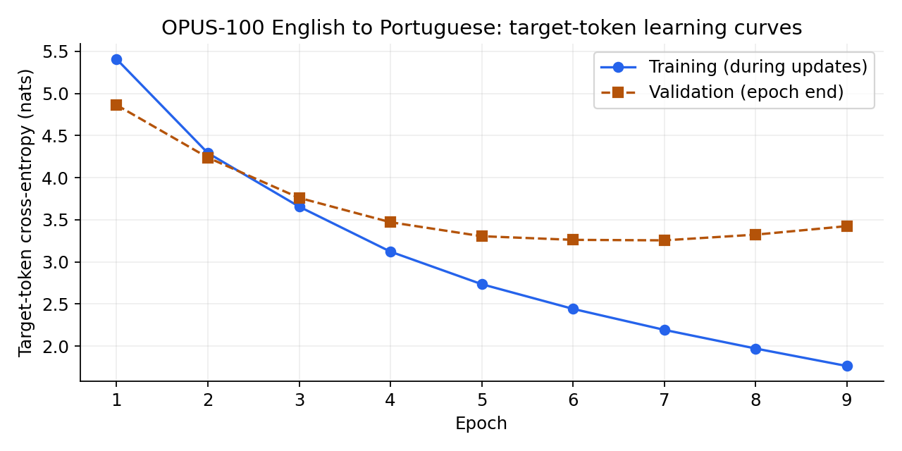

# Qwen3 Dense, from scratch: English → Portuguese

[](https://github.com/MedvAx-AI/qwen3-en-pt-from-scratch/actions/workflows/ci.yml)
[](https://colab.research.google.com/github/MedvAx-AI/qwen3-en-pt-from-scratch/blob/main/notebooks/experiment.ipynb)

**A hand-written, 5.07M-parameter decoder-only Transformer, trained from random
initialization to translate English into Portuguese.** This repository includes
the actual trained checkpoint, tokenizer, executable inference, architecture
tests, complete experiment outputs and an honest analysis of translation errors.

[Русское описание](README.ru.md) · [Executed experiment](notebooks/experiment.ipynb)
· [Russian annotated notebook / defense guide](notebooks/experiment_ru.ipynb)
· [Model card](docs/model-card.md) · [Next experiments](docs/roadmap.md)

This is an **educational architecture and training project**, not a pretrained
Qwen release or a production translator. Corpus BLEU is **9.52** on a declared
991-example filtered test subset. The model learns some short translations but
also omits meaning, mistranslates idioms and repeats fragments.

## Try the trained model

Python 3.10+ is required; the local verification and CI configuration use Python
3.13. The approximately 20MB checkpoint is included in Git. No API key, account,
dataset download, Git LFS or new training run is needed for inference.

```bash
git clone https://github.com/MedvAx-AI/qwen3-en-pt-from-scratch.git
cd qwen3-en-pt-from-scratch
python -m venv .venv
```

Activate the environment:

```bash
# Linux / macOS
source .venv/bin/activate
```

```powershell
# Windows PowerShell
.\.venv\Scripts\Activate.ps1
```

Install a CPU runtime and the package:

```bash
python -m pip install torch --index-url https://download.pytorch.org/whl/cpu
python -m pip install -e .
qwen3-translate "You can't tell what's inside!" --device cpu
```

Recorded and locally reproduced output:

```text
Não pode dizer o que está dentro!
```

The same CLI is available through:

```bash
python -m qwen3_translation "You can't tell what's inside!" --device cpu
python -m qwen3_translation --help
```

Run from the repository root, or supply `--artifacts /path/to/artifacts`.
`--device auto` selects CUDA when available; `--device cuda` requires a compatible
[GPU-enabled PyTorch installation](https://pytorch.org/get-started/locally/).
Source sentences must fit the training limit of 96 BPE tokens. Greedy decoding
stops at EOS or 97 new tokens; a smaller budget can be passed with
`--max-new-tokens`. These limits are validated rather than silently truncating text.

For Python use:

```python
from qwen3_translation.inference import load_model, translate

model, tokenizer = load_model("artifacts", device="cpu")
print(translate(model, tokenizer, "You can't tell what's inside!"))
```

## What is implemented

```text
<bos> <en> English tokens <pt> Portuguese tokens <eos>
                 ↓ shared 8k byte-level BPE vocabulary
Embedding → 4 × [pre-norm causal GQA + residual → pre-norm SwiGLU + residual]
          → final RMSNorm → tied vocabulary projection
```

- RMSNorm implemented from tensor operations with float32 reductions.
- Qwen split-half RoPE, applied **after separate per-head Q/K RMSNorm**.
- Grouped-query attention: 8 query heads, 2 KV heads, 4 queries per KV group.
- Explicit attention scores, consecutive KV grouping, causal and padding masks.
- Bias-free projections, dense SwiGLU, independent decoder layers and tied
  embedding/output weights.
- Target-only next-token cross-entropy: source and padding labels are ignored;
  the logit at `<pt>` predicts the first Portuguese token.
- Autoregressive greedy evaluation using English prompts alone.

No `nn.Transformer`, `nn.MultiheadAttention`, `scaled_dot_product_attention`,
ready-made decoder layers or pretrained language-model weights are used.
The query width is not assumed to equal hidden width; tests exercise unequal
`num_attention_heads * head_dim` and `hidden_size`.

The standalone model classes are extracted unchanged from the completed
experiment. The reusable inference wrapper adds input validation, device
selection and a tokenizer/checkpoint hash check. The original assignment already
provided the data/training/evaluation scaffold; see [provenance](NOTICE.md).

## Recorded experiment

| Item | Value |
| --- | ---: |
| Unique trainable parameters | 5,065,216 |
| Hidden / MLP width | 256 / 768 |
| Decoder layers | 4 |
| Q / KV heads; head dimension | 8 / 2; 32 |
| Vocabulary / context | 8,000 / 256 |
| Retained train / validation / test pairs | 49,567 / 984 / 991 |
| Completed / selected epoch | 9 / 7 |
| Best validation target-token loss | 3.2559 |
| Test target-token loss / perplexity | 3.3053 / 27.2574 |
| Autoregressive corpus BLEU | **9.5190** |
| Training device / time | Tesla T4 / 565.1 s |



Training loss continued falling after epoch 7 while validation loss rose.
Early stopping ended the run after epoch 9 and restored epoch 7. Test evaluation
followed validation-only checkpoint selection. The score is for a length-filtered
sample, **not the full OPUS-100 corpus**. BLEU is not percentage accuracy, and
perplexity is not directly comparable across different tokenizers.

SacreBLEU signature:

```text
nrefs:1|case:mixed|eff:no|tok:13a|smooth:exp|version:2.6.0
```

The tokenizer was trained only on training text. Official split boundaries were
preserved, and normalized exact holdout sentences were excluded from training.
These checks do not eliminate near-duplicates or noisy alignments.

Full evidence: [metrics](reports/metrics.json), [epoch history](reports/history.json),
[run configuration and versions](reports/run_metadata.json),
[all 991 generated translations and aligned references](reports/test_translations.json).

## Examples, including failures

These examples are taken from the recorded held-out run, not selected as a new
benchmark. They deliberately include both reasonable and poor outputs.

| English | Generated Portuguese | Observation |
| --- | --- | --- |
| You can't tell what's inside! | Não pode dizer o que está dentro! | Coherent translation; wording differs from the reference. |
| Sorry, homey. | Desculpa, para casa. | Mistranslates the colloquial address. |
| - Mery Christmas Mr Stewart. | - Mois Christmas Mr Stewart. | Partial English copying and malformed vocabulary. |

The long Rome-PE example loses the recommendations and internal-control
requirement. The creation-date example degenerates into repeated time fragments.
Across 991 outputs there are 0 empty hypotheses, 17 normalized exact reference
matches and 22 immediately repeated word-trigram cases. Those diagnostics are
not semantic accuracy and miss some character/subword repetition.

## Reproduce training and evaluation

Open the [executed notebook in Colab](https://colab.research.google.com/github/MedvAx-AI/qwen3-en-pt-from-scratch/blob/main/notebooks/experiment.ipynb),
select a T4 GPU runtime, and run all cells from a fresh session. The existing
outputs remain inspectable without rerunning.

The notebook uses the official OPUS-100 en-pt splits pinned to revision
`805090dc28bf78897da9641cdf08b61287580df9`, a 50k/1k/1k sampling budget,
an 8k training-only tokenizer and a 96/96 source/target token limit.
Training starts from random initialization with seed 42, AdamW (`lr=3e-4`,
`weight_decay=0.01`), batch size 32, gradient clipping at 1, CUDA float16 AMP,
and at most 10 epochs. Early stopping uses patience 2 and minimum improvement
0.001. Every new minimum validation loss is saved.

Optional local notebook execution, preferably with a GPU:

```bash
python -m pip install -e ".[train]"
python -m jupyter nbconvert --execute --to notebook --output experiment_rerun.ipynb --ExecutePreprocessor.timeout=-1 notebooks/experiment.ipynb
```

A rerun writes a new `assignment2_opus100_artifacts/` directory in its working
directory, preserving the baseline files under `artifacts/`. Numerical results
can vary slightly by hardware/PyTorch version despite the seed. The recorded
training environment was PyTorch 2.11.0+cu130 on a Tesla T4; the packaged model
was additionally checked on CPU with PyTorch 2.14.0. Installing the notebook's
data stack into a shared Colab environment can show conflicts with unused
preinstalled Transformers/cuDF packages; use a dedicated environment locally.

## Tests

```bash
python -m unittest discover -s tests -v
```

The nine CPU tests cover numerical RMSNorm/RoPE behavior, exact consecutive KV
grouping, causal/padding invariance, unequal attention/hidden widths, weight
tying, finite gradients and tiny-continuation learning, real checkpoint reload,
tokenizer mismatch rejection, input/context limits, CLI output and consistency
between the executed notebook and reported metrics. CI runs the tests and a
real translation on CPU.

## Project layout

```text
src/qwen3_translation/  Hand-written architecture and offline inference/CLI
artifacts/             best.pt, tokenizer.json and SHA256 checksums
notebooks/             Executed experiment and Russian commented study copy
reports/               Actual metrics, history, configuration and translations
assets/                Actual learning-curve figure
tests/                 Standard-library numerical and inference tests
docs/                  Model card and next experiments
```

## Portfolio scope

The current deliverable demonstrates Transformer internals, correct masking,
training from scratch, reproducible evidence, checkpoint packaging and tested
inference. Improving translation quality is a separate, measurable next step:
see the [roadmap](docs/roadmap.md). No baseline comparison, ablation study,
beam-search improvement or production-readiness claim is made.

## References and provenance

This project originated as PMLDL Assignment 2 (2026). Attribution and licensing
boundaries are recorded in [NOTICE.md](NOTICE.md).

- [Qwen3 Technical Report](https://arxiv.org/html/2505.09388v1#S2)
- [Official Qwen3 release](https://qwenlm.github.io/blog/qwen3/)
- [Qwen3-0.6B configuration](https://huggingface.co/Qwen/Qwen3-0.6B/blob/main/config.json)
- [Transformers v4.51.3 Qwen3 conventions](https://github.com/huggingface/transformers/blob/v4.51.3/src/transformers/models/qwen3/modeling_qwen3.py)
- [OPUS-100 dataset](https://huggingface.co/datasets/Helsinki-NLP/opus-100)
