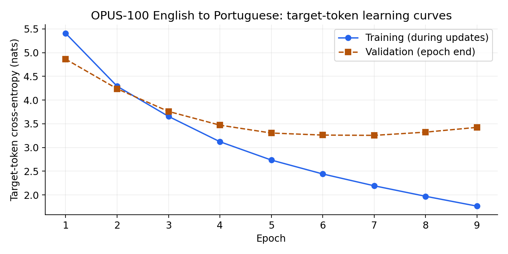

# Qwen3 Dense с нуля: английский → португальский

[English README](README.md) · [Ноутбук с русскими комментариями](notebooks/experiment_ru.ipynb)
· [Карточка модели](docs/model-card.md)

Учебный проект: самостоятельно реализованные основные компоненты Qwen3 Dense,
модель с **5 065 216 параметрами**, обучение со случайных весов, сохранённый
эксперимент и отдельный запуск перевода. Предобученный Qwen не используется.

Это демонстрация реализации Transformer и ML-конвейера. **Качество перевода
ограниченное:** BLEU 9.52 на 991 отфильтрованном тестовом примере. Модель может
терять смысл, неверно переводить разговорные выражения и повторять фрагменты.

## Запуск

Клонировать репозиторий, перейти в его папку и создать отдельное окружение:

```bash
git clone https://github.com/MedvAx-AI/qwen3-en-pt-from-scratch.git
cd qwen3-en-pt-from-scratch
python -m venv .venv
```

Активация: `source .venv/bin/activate` в Linux/macOS либо
`.\.venv\Scripts\Activate.ps1` в Windows PowerShell.

```bash
python -m pip install torch --index-url https://download.pytorch.org/whl/cpu
python -m pip install -e .
qwen3-translate "You can't tell what's inside!" --device cpu
```

Сохранённый и воспроизведённый результат:

```text
Não pode dizer o que está dentro!
```

Веса и токенизатор уже находятся в `artifacts/`: API-ключи, регистрация,
скачивание корпуса и повторное обучение для перевода не нужны.
Альтернативная команда: `python -m qwen3_translation "английская фраза"`.
Можно указать `--device cpu`, `--device cuda`, `--max-new-tokens` и путь
`--artifacts`. Вход ограничен 96 BPE-токенами, выход — по умолчанию 97 токенами.

## Что сделано

- RMSNorm, split-half RoPE, GQA с восемью Q-головами и двумя KV-головами.
- Отдельный QK-Norm перед RoPE, явные causal/padding маски.
- Dense SwiGLU, pre-norm residual-блоки и общие веса Embedding/LM head.
- Обучение на португальских целевых токенах и EOS, greedy-генерация без эталона.
- Проверки архитектуры, checkpoint/tokenizer, CLI и сохранённых результатов.

Конфигурация: 4 слоя, D=256, I=768, dh=32, общий словарь 8 000, контекст 256.
После фильтрации использованы 49 567/984/991 train/validation/test пар.
Обучение завершилось после 9 эпох, лучший checkpoint — эпоха 7:

| Метрика | Результат |
| --- | ---: |
| Лучший validation loss | 3.2559 |
| Test loss | 3.3053 |
| Test perplexity | 27.2574 |
| Autoregressive corpus BLEU | 9.5190 |



После эпохи 7 validation loss рос, хотя training loss продолжал снижаться:
ранняя остановка сохранила более раннюю модель. Test оценивался после выбора
по validation. BLEU — не процент точных переводов; метрики относятся к
ограниченной тестовой выборке, а не ко всему OPUS-100.

## Воспроизводимость и защита

Полный запуск с выводами находится в [experiment.ipynb](notebooks/experiment.ipynb).
В [experiment_ru.ipynb](notebooks/experiment_ru.ipynb) добавлены русские комментарии
к нашим реализациям и памятка для защиты. В обоих сохранены все 33 исходные
ячейки; удалены только временные элементы Colab и персональные метаданные сессии.
Оригинальные пользовательские файлы вне репозитория не изменялись.

Для повторного обучения открыть английский ноутбук в Colab, выбрать GPU и
выполнить все ячейки. Для показа уже обученной модели достаточно команды выше.
Метрики, история, версии и все тестовые переводы находятся в `reports/`.
Подробный протокол приведён в [English README](README.md).

```bash
python -m unittest discover -s tests -v
```

## Насколько это готово для портфолио

Проект уже показывает реализацию архитектуры с нуля, понимание масок/сдвига
целей, обучение, оценку, сохранение модели и рабочий inference. Для более
сильной исследовательской работы нужны сравнительный baseline и несколько
контролируемых экспериментов; для более качественного переводчика — улучшение
данных и режима обучения. Это отдельные следующие этапы, описанные в
[roadmap](docs/roadmap.md), а не уже выполненные достижения.

Задача, конфигурация и большая часть data/training/evaluation scaffold были
даны в учебном задании. Наш основной вклад — заполнение архитектурных реализаций,
проверки и инженерное оформление. См. [NOTICE.md](NOTICE.md).
